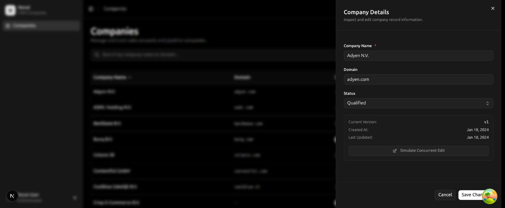
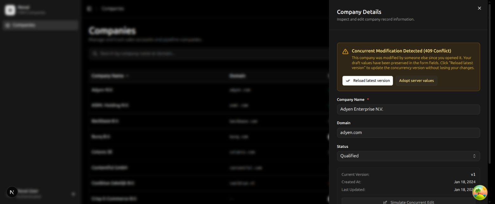

# Part 1: Written answers

## 1. Server and Client Components

I'd use Server Components for the page layout, metadata, and any work that needs server credentials. The search box, filters, and edit form need Client Components because they respond to input and hold local state. For example, `src/app/companies/page.tsx` is a Server Component, while `CompaniesView` is a Client Component containing the interactive table and drawer. I'd keep that boundary around the interactive part instead of making the whole app a Client Component.

The table and drawer shown here belong to `CompaniesView`. The page and layout around them stay as Server Components.

## 2. Fetching on the server with TanStack Query

I'd fetch on the server when having the first set of results in the initial HTML would noticeably improve the page load. I'd create a QueryClient for that request, prefetch with the same key the client uses, and pass the dehydrated cache through a HydrationBoundary. A suitable `staleTime` stops the client from immediately fetching the same data again. The server fetch also needs the user's token and a server-safe API URL; the browser client's relative URL won't work unchanged. I kept data loading on the client for this exercise.

## 3. Handling a 409 conflict

I'd keep the user's input and show a message explaining that someone else changed the record. Reloading should fetch the latest company into the query cache and update the version used for the next save, without replacing the form fields. If the user wants to discard their edits, that should be a separate action. The drawer implements both options, and a failed write does not update the cached company as though it succeeded.

Here, the edited name stays in the form after the save returns 409. Reloading the version lets the user retry without typing it again.

## 4. Filters, sorting, pagination, and the URL

I'd store these in the URL so the view can be bookmarked, refreshed, and restored with Back or Forward. Here, nuqs manages the parameters and pushes history entries when they change. The list query key uses the same values sent to the API: search, status, sort, limit, and the offset calculated from the page. That keeps the URL, request, and cache in sync.

## 5. Access tokens and expired sessions

I'd attach the bearer token in one request helper so individual components don't have to handle it. On a 401, that helper can try a refresh if the identity provider supports it; otherwise it should clear the session and send the user to sign-in. Tokens must stay out of URLs, logs, error reports, and source control. The exercise uses fake tokens stored in the browser; for production, I'd prefer a server-side session with an HttpOnly cookie and a proxy that forwards the access token.

## 6. Loading, error, and empty states

I'd keep the table and drawer independent so a failed detail request doesn't hide the list or navigation. `loading.tsx` can cover route loading, while separate Suspense boundaries are useful if the table and drawer use suspending queries. For ordinary `useQuery`, I'd render loading, retry, and empty states from the query result, which is what this build does. `keepPreviousData` keeps the existing rows visible while filters load; a 404 in the drawer gets its own not-found message. An unexpected rendering error can still be caught by an error boundary around the affected area.

## 7. Dutch and English

For an app that must ship only one language, I'd put the locale in the route or a cookie that the server can read. The server would load only that dictionary and pass the strings needed by Client Components through a provider. I'd use the same locale for `Intl.DateTimeFormat` and `Intl.NumberFormat` to avoid differences between server and client output. This small build bundles both dictionaries for a simple language toggle; I'd split them as the app grows.

## 8. Investigating a slow page

I'd first check whether the delay comes from the server response, API requests, JavaScript loading, hydration, or rendering after an interaction. TTFB, LCP, and INP help locate the problem, and the network panel and React Profiler help explain it. Two App Router features I'd consider are streaming with Suspense, to show the page shell while slower sections load, and server caching or revalidation for data that can safely be reused. I'd be careful with caching authenticated data: the cache must respect organization boundaries and permissions.

## 9. Testing approach

I'd unit test query keys, request headers, and error handling because those are easy to check without a browser. Component tests should cover the important workflows: filtering the list and editing through a 409, including checking that the typed draft survives the reload. This project also tests the actual route handlers, competing writes, field validation, and keyboard interaction with the drawer. I'd add browser tests for Back/Forward navigation, refresh, sign-in redirects, and two tabs editing the same record, since jsdom can't fully prove those behaviors.
