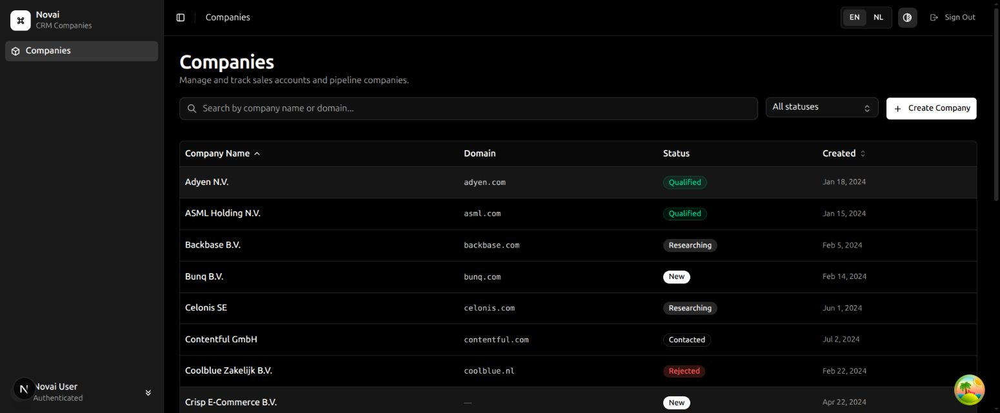

# Novai Companies

This is the Companies feature for the Novai assessment. It uses Next.js 16, React 19, TypeScript, Tailwind, TanStack Query, and nuqs. The API is built with Route Handlers and starts with 40 companies in memory.

[Live demo](https://novai-companies.usamaaslam.site) | [GitHub repository](https://github.com/U7ama/novai-companies) (private)



## Running it

Use Node.js 22 or newer and pnpm 10.

```bash
pnpm install --frozen-lockfile
pnpm dev
```

Open [localhost:3000](http://localhost:3000) and sign in with a non-empty demo token. If Turbopack cannot start its workers in your environment, use `pnpm dev --webpack`.

To check the project:

```bash
pnpm lint
pnpm typecheck
pnpm test
pnpm build
```

`pnpm start` runs the production build. The build script uses webpack because Turbopack's worker-port requirement caused problems in the restricted development environment. The UI uses system fonts, so the build doesn't need to download fonts.

Local development uses the requested in-memory store. It resets when the process restarts. The optional AWS deployment uses a small shared DynamoDB snapshot so Lambda instances agree on records and versions. See [DEPLOY.md](DEPLOY.md) for that setup.

## Main decisions

I used a small table built from shadcn/Base UI components. With four columns, two sortable fields, and one status filter, a generic table abstraction didn't add much here.

Search, status, sort, page, and the open drawer live in the URL. nuqs handles those values and the browser history. Search, filter, and sort changes reset the page. TanStack Query uses the corresponding API parameters as its query key, and `keepPreviousData` keeps the current table visible while new results load.

The edit form keeps its own draft and the version it was opened with. On a 409, **Reload latest version** fetches the current record and updates the version for the next save without changing the draft. **Adopt server values** replaces the draft when the user chooses to do so. A failed detail reload also leaves the typed values in place. The **Simulate Concurrent Edit** button makes this flow easy to try.

Create and update use TanStack Query mutations. Successful saves update the detail cache and invalidate the lists. Shared Zod schemas keep form and API validation consistent, and API field errors appear beside the relevant inputs.

The NL/EN toggle uses two small dictionaries and locale-aware date formatting. I kept both dictionaries in the client for this exercise rather than adding locale routes. The drawer uses Base UI's focus management and Escape handling, and rows and sort headers can be used with the keyboard.

## Auth and API

Sign-in is deliberately fake, as requested. The browser stores a token, the client adds it to each request, and a 401 clears it and redirects to sign-in. Existing token keys and cookie fallback remain supported.

The API supports list, detail, create, and update. Updates require `if_version`; stale writes return 409. Empty or invalid fields return 422, malformed JSON returns 400, and missing companies return 404. Authorized requests wait 300 to 800 ms outside tests so the loading states can be seen.

The API client is handwritten and typed, as if generated. It uses the mock API's `{ message, errors }` response shape rather than FastAPI's `detail` format.

## Tests and written answers

The nine written answers are in [ANSWERS.md](ANSWERS.md). [ARCHITECTURE.md](ARCHITECTURE.md) has a short walkthrough of the code.

The tests cover the client and query keys, route-handler behavior, validation, competing updates, list filtering, URL update options, and the 409 recovery flow. They also check that a failed refetch preserves the draft and that keyboard focus stays in the drawer and returns when it closes. Component tests use jsdom; they aren't a substitute for testing real browser navigation.

## What I'd change with more time

I'd add Playwright tests for browser history, refresh, sign-in redirects, and editing the same record in two tabs. For a real backend, I'd generate the client from OpenAPI, replace demo auth with a server-side session, and replace the small demo snapshot with a database model designed around individual company records. Server prefetching and loading only the selected language would be useful next steps if initial load time or bundle size became a problem.

## Left out

Fake sign-in and in-memory storage follow the assessment brief. The mock API doesn't validate identity, refresh tokens, or enforce tenant permissions. The local array resets when the server process restarts. The hosted demo shares state through DynamoDB, but authentication is still the fake assessment flow. A real product would need proper authentication and organization permissions.

Delete, bulk actions, contacts, deals, and exports are outside the requested feature.

## Known limitations

I focused on the requested workflows and left these cases for later:

- Drafts stay in memory while the drawer is open. Closing it, leaving the page, or refreshing loses unsaved changes, and there is no confirmation before leaving. I'd add an unsaved-changes prompt or draft recovery if this were used for longer forms.
- Create requests don't use idempotency keys. If the server creates a company but the response is lost, retrying could create a second record. I'd handle that with an idempotency key checked by the backend.
- Search sends requests as the user types. I haven't added debounce or cancellation of requests that are no longer needed. I'd add those if request volume became a problem.
- Automated tests use Vitest and jsdom. They cover the required workflows, but there is no automated browser suite for refresh, Back/Forward navigation, or two tabs editing at once. Those would be my first Playwright tests.

The required 409 recovery is implemented and tested: a rejected save and a version reload keep the user's draft in the open form.
